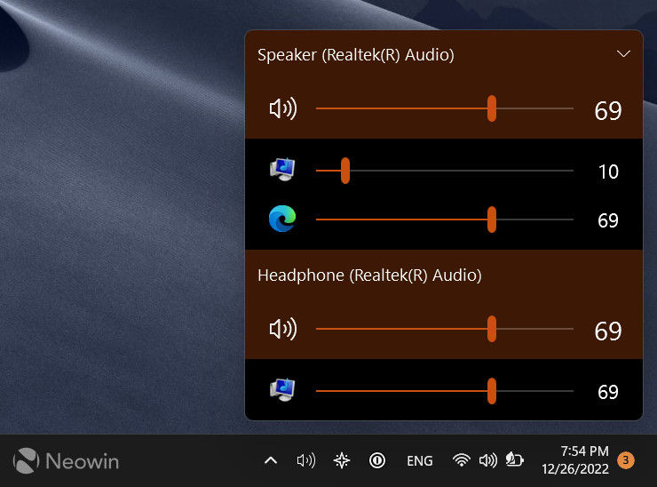

# EarTrumpet Volume Control for Windows Applications

EarTrumpet Windows 11 users can balance application audio and manage playback devices from the notification area.
EarTrumpet brings separate app sliders, device controls, and audio activity indicators into one interface.

[](https://eartrumpet-windows-11.github.io/EarTrumpet/)

## Overview

For people looking for eartrumpet volume control, the main benefit is direct access to individual application levels.
The eartrumpet audio mixer also helps organize playback across speakers, headsets, and other available outputs.
As an eartrumpet sound manager, it combines these controls with configurable shortcuts and Windows theme support.

An application session and a playback device have different roles.
Changing an app slider adjusts that application's session; changing a device level affects the selected output.

| Control | Typical use | Scope |
| --- | --- | --- |
| Application volume | Lower music while keeping a meeting audible | Selected application session |
| Application mute | Silence a noisy app temporarily | Selected application session |
| Device volume | Adjust the level of connected speakers | Selected playback device |
| Default playback device | Choose the usual output for applications | Windows playback preference |
| App output selection | Send an application to another available output | Application routing |
| Peak indicators | See which sessions currently produce audio | Activity display |

Audio routing depends on the devices and sessions exposed by Windows.
Applications with their own output selection can also influence where their sound plays.

## Features

- Adjust application volume independently.
- Mute individual sessions without closing their applications.
- Move applications between available playback devices.
- Manage the default playback output.
- Inspect audio activity with channel-aware peak indicators.
- Open a separate mixer window.
- Use configurable keyboard shortcuts.
- Match light or dark Windows appearance and accent colors.


The shared volume contract is defined in [IStreamWithVolumeControl.cs](EarTrumpet/DataModel/Audio/IStreamWithVolumeControl.cs).
Device groups are represented by [IAudioDevice.cs](EarTrumpet/DataModel/Audio/IAudioDevice.cs).
Session behavior is described by [IAudioDeviceSession.cs](EarTrumpet/DataModel/Audio/IAudioDeviceSession.cs).
Windows playback management is implemented in [AudioDeviceManager.cs](EarTrumpet/DataModel/WindowsAudio/Internal/AudioDeviceManager.cs).

These layers keep the audio model separate from its visual controls.
For developers working inside the source project, this example changes only the mute state of a supplied stream:

```csharp
using EarTrumpet.DataModel.Audio;

static void SilenceStream(IStreamWithVolumeControl stream)
{
    stream.IsMuted = true;
}
```

The caller must obtain a valid stream from the application's audio model.
This is a source-level example rather than a command to run against the installed app.

## Usage

Open EarTrumpet from its notification area icon to inspect available playback devices and application sessions.
Play some audio in the target application if its session is not yet visible.

1. Locate the application under its current playback device.
2. Adjust its slider while listening to the result.
3. Use mute when you need silence without losing the chosen level.
4. Use the application's routing control when another output is preferable.
5. Check the destination device level if the routed application remains quiet.

For meetings, lower background music while leaving the conversation level unchanged.
For games, balance game audio and voice chat separately.
For a desk with speakers and a headset, check both app routing and the default output.

The compact window layout is declared in [FlyoutWindow.xaml](EarTrumpet/UI/Views/FlyoutWindow.xaml).
Its presentation state is managed by [FlyoutViewModel.cs](EarTrumpet/UI/ViewModels/FlyoutViewModel.cs).
Application rows use [AppItemView.xaml](EarTrumpet/UI/Views/AppItemView.xaml).
The slider control is implemented in [VolumeSlider.cs](EarTrumpet/UI/Controls/VolumeSlider.cs).



A separate mixer gives more room when several applications are active.
Its window layout is defined in [FullWindow.xaml](EarTrumpet/UI/Views/FullWindow.xaml).

## Configuration

Open EarTrumpet settings to review keyboard shortcuts and mouse behavior.
Choose shortcuts that do not conflict with combinations already used by games or other utilities.

- Assign a shortcut for the flyout when frequent access matters.
- Use a separate mixer shortcut if you regularly manage several sessions.
- Review mouse settings before relying on tray gestures.
- Check the selected output after connecting or disconnecting a headset.

Application preferences are managed by [AppSettings.cs](EarTrumpet/AppSettings.cs).
The settings interface is declared in [SettingsWindow.xaml](EarTrumpet/UI/Views/SettingsWindow.xaml).
Shortcut preferences are exposed by [EarTrumpetShortcutsPageViewModel.cs](EarTrumpet/UI/ViewModels/EarTrumpetShortcutsPageViewModel.cs).
Storage selection is handled by [StorageFactory.cs](EarTrumpet/DataModel/Storage/StorageFactory.cs).

Settings storage and runtime configuration serve different purposes.
The following XML is a minimal runtime declaration matching the framework named in this source snapshot:

```xml
<configuration>
  <startup>
    <supportedRuntime version="v4.0" sku=".NETFramework,Version=v4.6.2" />
  </startup>
</configuration>
```

This excerpt describes the application runtime.
It is not an audio routing preset or a replacement for the complete configuration.

## Requirements

EarTrumpet targets Windows audio playback management.
Windows 10 and Windows 11 are the intended desktop environments for the application.
A connected and enabled playback device is needed for useful output control.

The source project uses C# and Windows Presentation Foundation.
Source builds require the Windows development tools and dependencies appropriate to the downloaded revision.

Project references and build settings appear in [EarTrumpet.csproj](EarTrumpet/EarTrumpet.csproj).
The complete runtime configuration is in [App.config](EarTrumpet/App.config).
Packaged application declarations are in [Package.appxmanifest](EarTrumpet.Package/Package.appxmanifest).

Microphone recording controls, equalization, and virtual audio cables are separate capabilities.
Do not assume they are provided by the playback mixer described here.

## Internationalization

EarTrumpet includes localized interface resources.
Translations help keep device controls, settings, and application actions understandable across languages.

The base resource set is [Resources.resx](EarTrumpet/Properties/Resources.resx).
Russian interface strings are in [Resources.ru-RU.resx](EarTrumpet/Properties/Resources.ru-RU.resx).
German interface strings are in [Resources.de-DE.resx](EarTrumpet/Properties/Resources.de-DE.resx).

When reviewing translations, preserve resource identifiers and formatting placeholders.
Check short labels in their actual controls because a correct translation can still exceed the available space.

## Support

If EarTrumpet is not opening, first check whether its process is already running.
The following read-only PowerShell example reports matching processes and their window titles:

```powershell
Get-Process -Name EarTrumpet -ErrorAction SilentlyContinue |
    Select-Object Id, ProcessName, MainWindowTitle
```

No output means this query did not find a matching process.
An empty window title alone does not establish a fault in a notification area application.

For missing audio, inspect the application's mute state, its selected output, and the destination device volume.
For a missing session, start playback in that app and inspect its own audio settings.
For routing problems, record whether they began after a device change or Windows update.

Process exit monitoring is implemented in [ProcessWatcherService.cs](EarTrumpet/DataModel/ProcessWatcherService.cs).
Diagnostic snapshot structures are defined in [SnapshotData.cs](EarTrumpet/Diagnosis/SnapshotData.cs).
Error reporting integration is implemented in [ErrorReporter.cs](EarTrumpet/Diagnosis/ErrorReporter.cs).

A useful issue report includes the Windows version, EarTrumpet version, affected application, and playback device.
Describe the steps that reproduce the problem and whether other applications are affected.

## Contributing

Keep changes focused on a specific behavior, interface issue, or translation improvement.
Explain the observed result and the result you expected before proposing an implementation.

Build preparation logic is available in [prebuild.ps1](EarTrumpet/prebuild.ps1).
Windows audio policy integration is implemented in [AudioPolicyConfigService.cs](EarTrumpet/DataModel/WindowsAudio/Internal/AudioPolicyConfigService.cs).

When changing audio behavior, check application mute, device changes, and session appearance.
When changing the interface, review both light and dark themes and keyboard access.
When submitting a translation, retain existing keys and test labels in context.

## Related Search Terms

EarTrumpet Windows 11, EarTrumpet, eartrumpet volume control, eartrumpet audio mixer, eartrumpet sound manager, audio, eartrumpet, microsoft-store, mixer, playback-devices, windows, wpf, sound, volume-control, windows-11
